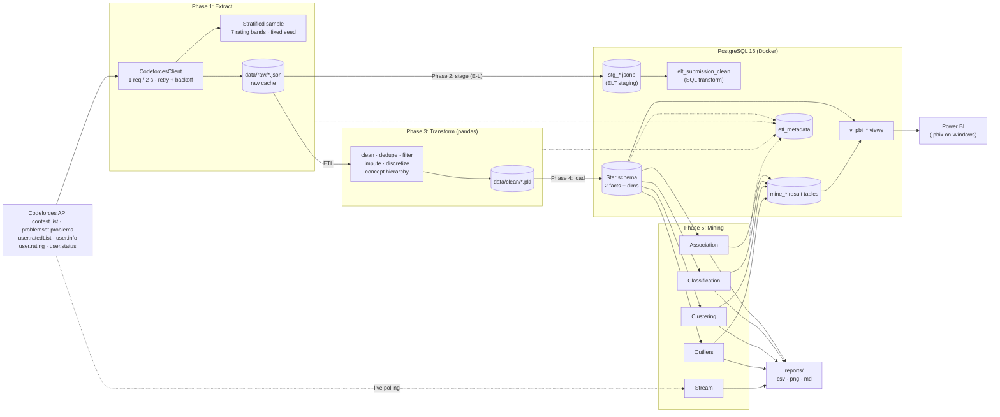
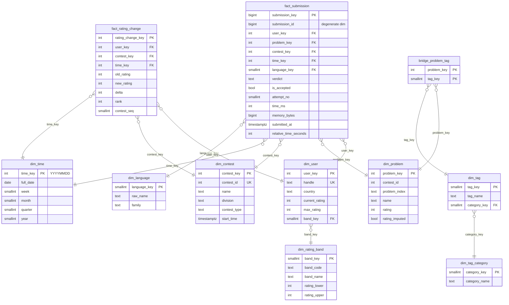

# CFIQ: Competitive Programming Analytics Warehouse and Mining Engine

A Data Mining & Data Warehousing (DMDW) project on Codeforces data. CFIQ extracts data
from the public Codeforces API, stages it raw in PostgreSQL (ELT), cleans and
transforms it in Python (ETL), loads a star/snowflake warehouse with OLAP queries
and Power BI views, and runs four mining modules: association rules, classification,
clustering and outlier detection. A stream-mining demo is optional.

Every course topic maps to one module, and each module's docstring names its topic:

| DMDW topic | Where |
|---|---|
| Extraction, rate limiting, retry, caching | `cfiq/extract/client.py` |
| Data reduction: stratified sampling | `cfiq/extract/sampling.py` |
| ETL vs ELT (staging raw jsonb, SQL transform) | `cfiq/staging/stage.py`, `cfiq/staging/elt.py`, `sql/elt_transform.sql` |
| Cleaning & integration (dedupe, filters, joins) | `cfiq/transform/clean.py` |
| Missing values (impute vs drop) | `cfiq/transform/impute.py` |
| Normalization (min-max, z-score) | `cfiq/transform/scale.py` |
| Discretization & concept hierarchies | `cfiq/transform/discretize.py`, `config/tag_hierarchy.yaml` |
| Star schema, snowflake, fact constellation, surrogate keys | `sql/schema.sql`, `cfiq/warehouse/load.py` |
| OLAP: roll-up, drill-down, slice, dice, pivot, ROLLUP, CUBE, GROUPING SETS | `sql/olap_queries.sql`, `cfiq/warehouse/olap.py` |
| BI layer | `sql/powerbi_views.sql` |
| Association rules: Apriori vs FP-Growth, constraint-based mining | `cfiq/mining/association.py` |
| Classification: ID3/CART trees, Naive Bayes, SVM, MLP, Random Forest | `cfiq/mining/classification.py` |
| Clustering: K-means, agglomerative, DBSCAN | `cfiq/mining/clustering.py` |
| Outlier analysis: z-score, IQR | `cfiq/mining/outliers.py` |
| Stream mining (optional) | `cfiq/mining/stream.py` |
| ETL audit metadata | `sql/etl_metadata.sql` (`etl_metadata` table, every phase) |

---

## Setup

Prerequisites: Python 3.11+, [uv](https://docs.astral.sh/uv/), Docker Desktop.
On Windows + WSL2, enable *Docker Desktop → Settings → Resources → WSL integration*
for your distro.

```bash
cp .env.example .env          # DB credentials, SAMPLE_SIZE, RANDOM_SEED
uv sync                       # creates .venv with every dependency
docker compose up -d          # Postgres 16 on :5432, pgAdmin on http://localhost:5050
uv run pytest                 # 98 tests (DB integrity tests skip if the warehouse isn't loaded)
```

Configuration lives in two places. Nothing is hard-coded in Python.

- `.env`: database credentials, `SAMPLE_SIZE`, `RANDOM_SEED` (these override the YAML).
- `config/cfiq.yaml`: API settings, rating bands, cleaning rules, division and language
  mappings, and every mining parameter. `config/tag_hierarchy.yaml` holds tag → category.

## Running

```bash
uv run cfiq extract                  # API -> data/raw (cached; reruns make 0 API calls)
uv run cfiq stage                    # data/raw -> stg_* jsonb tables (ELT)
uv run cfiq transform                # data/raw -> data/clean (ETL) + ELT SQL comparison
uv run cfiq load                     # star schema + Power BI views
uv run cfiq olap                     # OLAP queries -> reports/olap/*.csv
uv run cfiq mine                     # 4 mining modules -> reports/ + mine_* tables
uv run cfiq mine --only clustering   # a single module
uv run cfiq stream                   # optional: replay a contest as a stream
uv run cfiq stream --live --contest-id 2287 --polls 5   # optional: poll the live API

uv run cfiq all                      # everything except stream, end to end
```

Every step is idempotent. Staging and the warehouse are full-refresh (drop and
recreate), mining tables are delete-and-reinsert, and `etl_metadata` is an
append-only audit log. Once the cache is filled, `cfiq all` runs in about 2.5 minutes
with zero API calls.

**Sample size.** The default is N = 3000, as specified. At the API limit of one call
every 2 s that is about 6000 calls, or roughly 3.5 hours for the first run. The results
below come from **N = 350** (50 users per band; set in `.env`), which took about 25
minutes to extract.

**Notebooks.** There is one notebook per module, with outputs already saved:

```bash
uv run jupyter lab notebooks/                      # open for the demo
uv run python scripts/build_notebooks.py           # regenerate from source
uv run jupyter nbconvert --to notebook --execute --inplace notebooks/*.ipynb
```

| Notebook | Content |
|---|---|
| `00_warehouse_olap` | etl_metadata, jsonb staging, ETL vs ELT, star schema counts, every OLAP query |
| `01_association` | transactions, Apriori vs FP-Growth, rules, constraints |
| `02_classification` | feature building, time split, model table, confusion matrices, impute/drop, scaling |
| `03_clustering` | user vectors, elbow/silhouette, dendrogram, k-distance, PCA view, cluster descriptions |
| `04_outliers` | ranked rating jumps and submission bursts |
| `05_stream` | contest replayed as a stream |

---

## Architecture



## Warehouse schema

The core is a star schema around `fact_submission`. A second fact table,
`fact_rating_change`, shares the user, contest and time dimensions, so together they
form a **fact constellation**. Two dimensions are **snowflaked**: user → rating band,
and tag → tag category. Problems and tags are many-to-many, resolved through a bridge
table. Every dimension has a surrogate integer key, and the facts' foreign keys are
indexed.



---

## Connecting Power BI

Postgres runs in Docker Desktop and publishes port 5432 on the Windows host, so Power BI
Desktop on the same machine connects to `localhost`.

1. Run `docker compose up -d` and `uv run cfiq all`, so the views exist and hold data.
2. In Power BI Desktop, choose **Get Data → PostgreSQL database**.
   - Server: `localhost:5432`
   - Database: `cfiq`
   - Data connectivity mode: **Import** (recommended at this size) or DirectQuery.
3. Credentials: choose **Database**, with the user and password from `.env`
   (`cfiq` / `cfiq` by default).
   If you get an SSL or encryption error, untick *Encrypt connection*. The local
   container has no TLS. Recent Power BI versions bundle the Npgsql driver; older ones
   ask you to install it.
4. In the Navigator, select the `v_pbi_*` views:

| View | Suggested visual |
|---|---|
| `v_pbi_acceptance_by_tag_band` | Matrix: tag_category → tag (rows) × rating_band (columns), value = acceptance_rate. Sort bands by `band_order`. |
| `v_pbi_language_usage_monthly` | Stacked area: month_start × submissions by language_family |
| `v_pbi_rating_progression` | Line: rating_date × new_rating, with a slicer on handle / current_band |
| `v_pbi_verdicts` | 100% stacked bar: rating_band × submissions by verdict |
| `v_pbi_assoc_rules` | Table filtered by rule_set; scatter of support × confidence, sized by lift |
| `v_pbi_model_comparison` | Clustered bar: model × f1, legend = experiment |
| `v_pbi_user_clusters` | Scatter: current_rating × cluster, slicer on algorithm |
| `v_pbi_anomalies` | Table: anomaly_type, rank, handle, contest_name, value, score |

pgAdmin is available at <http://localhost:5050>. Register a server with host
`postgres`, port `5432`, and the credentials from `.env`.

---

## Results

All results come from N = 350 users (50 per band), seed 42. Every number below is
regenerated by `cfiq all` into `reports/`.

### Extraction and preprocessing

| Endpoint | Rows |
|---|---:|
| contest.list (gym = false) | 2,172 |
| problemset.problems | 11,541 |
| user.ratedList (population) | 42,145 |
| stratified sample | 350 (50 per band) |
| user.rating (rating changes) | 17,390 |
| user.status (submissions) | 546,417 |

Cleaning (full table in [`reports/preprocessing.md`](reports/preprocessing.md)):

| Step | Rows |
|---|---:|
| Raw | 546,417 |
| Dedupe by id | 545,434 |
| Drop gym and missing contest | 477,257 |
| Keep only official participations (drop practice, virtual, unofficial) | **148,643** |

- **Missing ratings.** 489 of 12,999 problems (3.8%) have no rating. The spec
  estimated about 20%; the real figure for this sample is lower. Those problems account
  for 17,624 clean submissions (12%).
- **ETL vs ELT** ([`reports/etl_vs_elt.md`](reports/etl_vs_elt.md)). Both paths give
  exactly **148,643** rows. The SQL in Postgres over staged jsonb takes 1.2 s; pandas
  takes 13–20 s, including reading the JSON files.

### Warehouse and OLAP

The warehouse holds 148,643 submission facts and 17,390 rating-change facts, across 350
users, 2,172 contests, 12,999 problems, 39 tags in 7 categories, 63 raw languages and
1,567 dates. The referential-integrity tests confirm that every foreign key resolves and
is declared.

Roll-up to tag category (acceptance %): math 51.8 · strings 51.5 · algorithms 50.4 ·
implementation 44.8 · data structures 44.5 · **graph theory 36.4** · other (meta tags)
13.0.
The pivot (category × band) shows Grandmasters with the highest acceptance in most
categories. The exception is implementation, where acceptance is flat at 44–49% across
all bands. All eight query outputs are in `reports/olap/`.

### Association rules ([summary](reports/association/summary.md))

- **Transactions:** 346 users, averaging 23.7 of 39 tags each. That is very dense.
  Seven near-universal tags (support ≥ 0.95, e.g. *implementation*, *math*, *greedy*)
  were removed, since they only produce rules with lift ≈ 1.
- **Mining:** with support ≥ 0.4, confidence ≥ 0.8, lift ≥ 1.1 and max length 3, this
  gives 760 frequent itemsets and 1,568 rules.
- **Apriori vs FP-Growth** (identical itemsets, timed on two data shapes):

| Data | Faster algorithm |
|---|---|
| 346 dense user transactions | **Apriori**, 3–5× faster at every support (vectorized NumPy, few rows) |
| 19,086 sparse contest baskets | Apriori wins at high support; even at 0.03–0.05; **FP-Growth ~4× faster at 0.01** (32k itemsets: ~0.8–1.0 s vs ~3.5 s) |

- **Constraint-based mining:**
  - Restricting to Grandmasters gives 830 rules, e.g. {meet-in-the-middle} ⇒ {flows,
    schedules}.
  - The "graph theory only" constraint, pushed into mining, gives 18 rules, e.g.
    {shortest paths} ⇒ {dfs and similar, graphs} with confidence 0.97 and lift 1.33.
- **How to read the rules:** many general rules encode breadth of experience. A rare tag
  on the left side mostly signals a strong user, which is exactly why the band
  constraint is useful.

### Classification ([summary](reports/classification/summary.md))

- **Task:** 140,360 (user, problem) pairs. For every contest a user entered, each
  problem in it is a candidate. 49.4% were solved.
- **Features:** 19 in total, all computed from information available before the
  contest.
- **Time-based split:** 112,075 training pairs and 28,285 test pairs. Test contests run
  from 2026-03-16 onward, and no contest appears on both sides.

| Model | Accuracy | Precision | Recall | F1 |
|---|---:|---:|---:|---:|
| Baseline (predict solved if problem ≤ user rating) | 0.871 | 0.907 | 0.824 | 0.864 |
| Decision Tree, entropy (≈ ID3) | 0.884 | 0.902 | 0.860 | 0.881 |
| Decision Tree, gini (CART) | 0.886 | 0.893 | 0.875 | 0.884 |
| Gaussian NB | 0.809 | 0.870 | 0.722 | 0.789 |
| Bernoulli NB | 0.848 | 0.854 | 0.835 | 0.845 |
| SVM (RBF, 8k-row subsample) | 0.890 | 0.883 | **0.895** | 0.889 |
| MLP (32-16) | 0.890 | 0.890 | 0.889 | 0.889 |
| **Random Forest** | **0.891** | 0.892 | 0.887 | **0.889** |

Confusion matrices are in `reports/classification/confusion_matrices.png`.

- **Impute vs drop.** Dropping unrated problems seems to raise F1 by about 0.011. On
  identical test rows, though, the difference is −0.001. The apparent gain comes only
  from dropping the hardest test rows. Imputation keeps 6% more data at no cost.
- **Z-score vs min-max.** Tree models are identical under both, since rescaling doesn't
  change their splits. SVM and Bernoulli NB lose 0.005–0.006 F1 under min-max. Gaussian
  NB is unchanged, because it standardizes each feature internally anyway.
- **Caveat.** Codeforces computes problem ratings after a contest. `problem_rating`
  therefore carries some post-contest information, which the report discusses.

### Clustering ([summary](reports/clustering/summary.md))

- **Data:** 324 users with at least 20 solves. Each user is a vector of solve shares
  across 6 topic categories plus rating, all z-scored.
- **Choosing k:** the elbow knee is at k = 5. Silhouette peaks at k = 2, but that split
  just separates strong from weak users. The chosen k = 3 is the best silhouette with
  k ≥ 3.

| Algorithm | Clusters | Noise | Silhouette |
|---|---:|---:|---:|
| K-means | 3 | 0 | **0.237** |
| Agglomerative (Ward) | 3 | 0 | 0.214 |
| DBSCAN (min_samples 8) | 1 | 90 | n/a |

K-means clusters in plain words:
- **Pupils, ~1340 (74 users):** solve relatively more *implementation* and *strings*,
  less *graph theory* and *algorithms*.
- **Specialists, ~1580 (118 users):** lean on *algorithms* (dp, greedy, binary search),
  less *data structures* and *graph theory*.
- **Masters, ~2280 (132 users):** solve relatively more *graph theory* and *data
  structures*, less *strings* and *math*.

Agglomerative clustering finds the same three profiles. DBSCAN finds no density-separated
groups with at most 30% noise: the users form one continuous core of 234, and the 90
noise points are unusual tag mixes. That agrees with the modest silhouette scores.

### Outliers ([summary](reports/outliers/summary.md))

- **Rating jumps.** 15,321 rating changes were checked, skipping each user's first 6
  contests where newcomer boosts are normal. 234 were flagged: 42 by the per-user
  |z| > 3 rule and 230 by the global IQR fences [−170, 186]. The top one is a +515 jump
  (1219 → 1734), 4.7 standard deviations above that user's own history.
- **Submission bursts.** 19,539 (user, contest) pairs were checked, and 81 flagged (both
  rules required, since IQR = 0 on this data). Every top burst comes from the *Pinely
  Treasure Hunt Contest*, a special-format event where rapid submissions are expected.
  That's a good illustration of why an outlier is a candidate for review, not a verdict.

### Stream mining ([summary](reports/stream/summary.md))

Contest 2287 (the latest Div. 1) was replayed in batches of 500, with each submission
seen once. Running and sliding-window acceptance rates update in O(1) per submission.
Final result: 4,292 submissions, 62.4% accepted.

---

## Design decisions (viva notes)

- **Equal-allocation stratified sample.** Proportional allocation would give the GM band
  only a handful of users and starve the mining modules.
- **Two kinds of FAILED responses.** Transient ones (e.g. "Call limit exceeded") are
  retried with backoff of 2, 4, 8, 16, 32 s. Permanent ones ("handle not found") fail
  immediately. The patterns are set in YAML.
- **Only `CONTESTANT` submissions are kept.** This follows the spec (drop practice,
  virtual and unofficial) and removes 69% of raw rows. All mining therefore describes
  in-contest behavior.
- **Problems are integrated from two sources:** `problemset.problems`, plus problems
  that appear only inside submissions, giving 12,999 vs 11,541.
- **Imputation rounds to the nearest 100,** because real Codeforces ratings are
  multiples of 100. Imputed values are flagged (`rating_imputed`), so the drop strategy
  is simply a filter.
- **No leakage in classification.** Past solve rates come from strictly earlier
  contests via a cumulative sum minus the current contest; this is tested. The user's
  rating is taken as-of before the contest, also tested. Scalers are fitted on the
  training set only, and the split never puts one contest on both sides.
- **The classification target includes unattempted problems.** With only attempted
  problems, 87% of pairs are positive (people mostly submit what they can solve), which
  makes the task trivial.
- **`dim_time` uses a smart key, YYYYMMDD.** It's still a meaningless-to-users integer
  surrogate, but readable and naturally ordered.
- **COUNT(DISTINCT submission_key) at tag level.** The problem–tag bridge is
  many-to-many, so a plain COUNT would double-count submissions.

## Tests

`uv run pytest` runs 98 tests:

| File | Covers |
|---|---|
| `tests/test_client.py` | Rate limiter spacing, retry on 429/5xx/network/FAILED, permanent errors not retried, exponential backoff, give-up, disk cache |
| `tests/test_transform.py` | Dedupe, participant/gym/verdict filters, problem join and attempt numbering, imputation (group median, fallback, rounding, drop), min-max/z-score (train-fitted), tag/language/division hierarchies |
| `tests/test_sampling.py` | Band boundaries, quota allocation, deterministic stratified sample |
| `tests/test_mining.py` | No-leakage past solve rates, as-of rating join, time split, rule metrics, IQR/z helpers, incremental stream stats, OLAP file parsing |
| `tests/test_warehouse_integrity.py` | Zero orphan FKs and declared FK constraints for all 12 relationships, unique submission ids, every user has a band (runs against the loaded DB) |

## Repository layout

```
docker-compose.yml   pyproject.toml   .env.example
config/              cfiq.yaml (all settings), tag_hierarchy.yaml
cfiq/
  extract/           client.py, sampling.py, pipeline.py, raw_reader.py
  staging/           stage.py (raw -> jsonb), elt.py (SQL transform)
  transform/         clean.py, impute.py, scale.py, discretize.py, pipeline.py
  warehouse/         load.py, olap.py
  mining/            association.py, classification.py, clustering.py, outliers.py, stream.py
  cli.py  config.py  db.py
sql/                 schema.sql, olap_queries.sql, powerbi_views.sql,
                     staging_schema.sql, elt_transform.sql, etl_metadata.sql, mining_schema.sql
notebooks/           00..05 demo notebooks (generated by scripts/build_notebooks.py)
reports/             generated csv / png / md (summary.md per module)
tests/
data/                raw cache + clean pickles (git-ignored)
```
