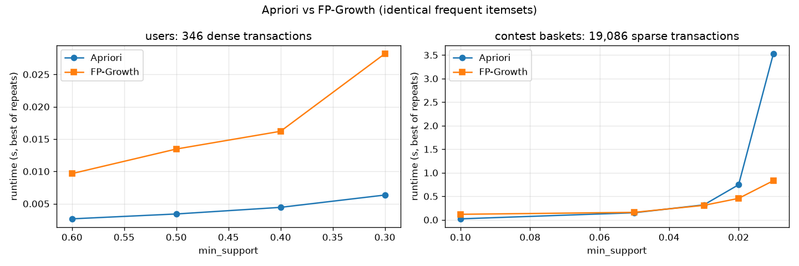

# Association rules: tag pattern miner

- Transactions (users): **346**, mean tags per user: **23.7** of 39
- Dropped ubiquitous items (support >= 0.95): brute force, constructive algorithms, greedy, implementation, math, sortings, strings
- min_support = 0.4, min_confidence = 0.8, min_lift = 1.1, max_len = 3
- Frequent itemsets: **760**; rules (all users): **1568**

## Apriori vs FP-Growth (same min_support, same itemsets)

### users: 346 dense transactions

| min_support | itemsets | apriori_s | fpgrowth_s | apriori_over_fpgrowth |
|---|---|---|---|---|
| 0.6000 | 364 | 0.0027 | 0.0097 | 0.2756 |
| 0.5000 | 526 | 0.0034 | 0.0135 | 0.2537 |
| 0.4000 | 760 | 0.0044 | 0.0162 | 0.2739 |
| 0.3000 | 1598 | 0.0063 | 0.0282 | 0.2249 |

### contest baskets: 19,086 sparse transactions

| min_support | itemsets | apriori_s | fpgrowth_s | apriori_over_fpgrowth |
|---|---|---|---|---|
| 0.1000 | 471 | 0.0204 | 0.1169 | 0.1749 |
| 0.0500 | 1986 | 0.1499 | 0.1583 | 0.9472 |
| 0.0300 | 5179 | 0.3174 | 0.3071 | 1.0336 |
| 0.0200 | 10491 | 0.7448 | 0.4550 | 1.6368 |
| 0.0100 | 32289 | 3.5287 | 0.8310 | 4.2462 |

Apriori generates candidates level by level and scans the data once per level; mlxtend's implementation does this with vectorised NumPy, which is very fast when there are few transactions (the dense per-user data). FP-Growth builds a compressed FP-tree and grows patterns without candidate generation; it wins on the large, sparse contest baskets, and its lead grows as min_support drops and the number of candidate itemsets explodes.

## Top rules, all users (by lift)

| antecedents | consequents | support | confidence | lift |
|---|---|---|---|---|
| divide and conquer | geometry, trees | 0.439 | 0.835 | 1.505 |
| divide and conquer | dsu, interactive | 0.436 | 0.830 | 1.495 |
| hashing | combinatorics, geometry | 0.405 | 0.870 | 1.475 |
| divide and conquer | dsu, trees | 0.480 | 0.912 | 1.475 |
| divide and conquer | combinatorics, interactive | 0.448 | 0.852 | 1.473 |
| hashing | dfs and similar, geometry | 0.416 | 0.894 | 1.467 |
| divide and conquer | interactive, trees | 0.454 | 0.863 | 1.463 |
| divide and conquer | combinatorics, dsu | 0.480 | 0.912 | 1.461 |
| hashing | geometry, graphs | 0.402 | 0.863 | 1.457 |
| divide and conquer | combinatorics, trees | 0.497 | 0.945 | 1.447 |
| divide and conquer | dsu, geometry | 0.431 | 0.819 | 1.438 |
| divide and conquer | dfs and similar, interactive | 0.451 | 0.857 | 1.433 |
| divide and conquer | graphs, interactive | 0.454 | 0.863 | 1.428 |
| divide and conquer | combinatorics, geometry | 0.439 | 0.835 | 1.417 |
| hashing | bitmasks, geometry | 0.416 | 0.894 | 1.413 |

Reading the rules: a rare tag on the left (e.g. *divide and conquer*) mostly signals an experienced user, who has therefore solved many other tags too, so many rules encode breadth of experience rather than a topic link. Restricting to one band (below) holds experience roughly constant; the category constraint keeps only within-topic links.

## Constraint: band = GM only (50 users, 830 rules)

| antecedents | consequents | support | confidence | lift |
|---|---|---|---|---|
| communication, flows | expression parsing | 0.420 | 0.875 | 1.367 |
| chinese remainder theorem, communication | expression parsing | 0.420 | 0.875 | 1.367 |
| communication | expression parsing, flows | 0.420 | 0.808 | 1.346 |
| communication | chinese remainder theorem, expression parsing | 0.420 | 0.808 | 1.346 |
| meet-in-the-middle | schedules, ternary search | 0.420 | 0.913 | 1.343 |
| meet-in-the-middle | chinese remainder theorem, schedules | 0.420 | 0.913 | 1.343 |
| meet-in-the-middle | flows, schedules | 0.440 | 0.957 | 1.329 |
| schedules, string suffix structures | *special | 0.560 | 0.903 | 1.328 |
| *special | schedules, string suffix structures | 0.560 | 0.824 | 1.328 |
| expression parsing, schedules | *special | 0.500 | 0.893 | 1.313 |

## Constraint: all items in category 'graph theory' (pushed into mining, 18 rules)

| antecedents | consequents | support | confidence | lift |
|---|---|---|---|---|
| shortest paths | dfs and similar, graphs | 0.402 | 0.972 | 1.329 |
| dfs and similar, shortest paths | graphs | 0.402 | 0.993 | 1.282 |
| dfs and similar, graphs | trees | 0.679 | 0.929 | 1.270 |
| trees | dfs and similar, graphs | 0.679 | 0.929 | 1.270 |
| shortest paths | graphs | 0.405 | 0.979 | 1.264 |
| graph matchings | graphs | 0.402 | 0.959 | 1.238 |
| graphs, shortest paths | dfs and similar | 0.402 | 0.993 | 1.227 |
| graphs, trees | dfs and similar | 0.679 | 0.992 | 1.225 |
| dfs and similar | graphs, trees | 0.679 | 0.839 | 1.225 |
| dfs and similar | trees | 0.723 | 0.893 | 1.221 |
