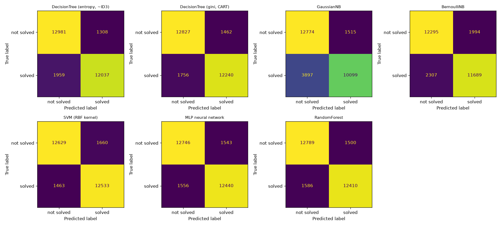
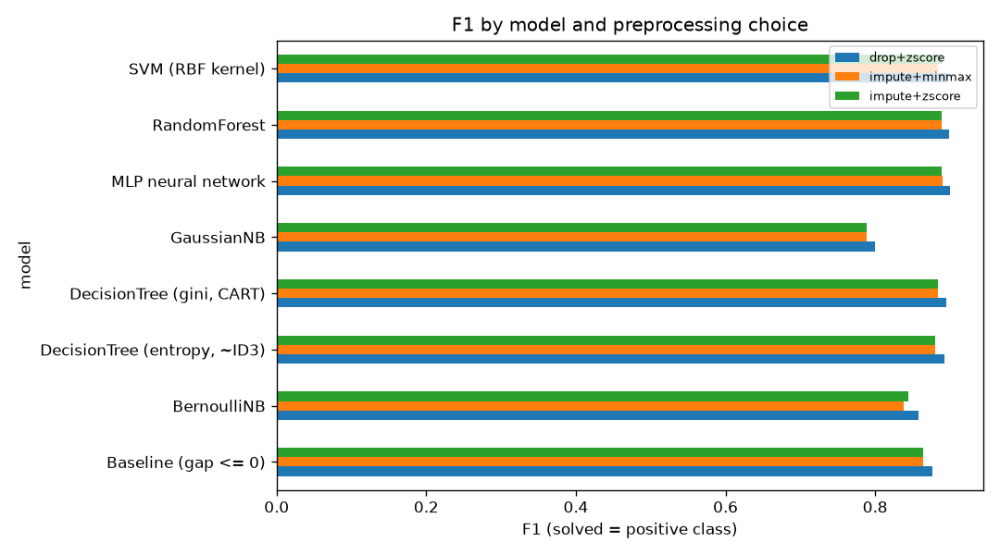
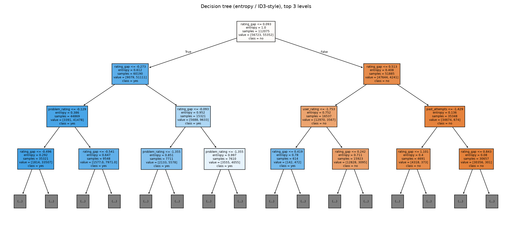
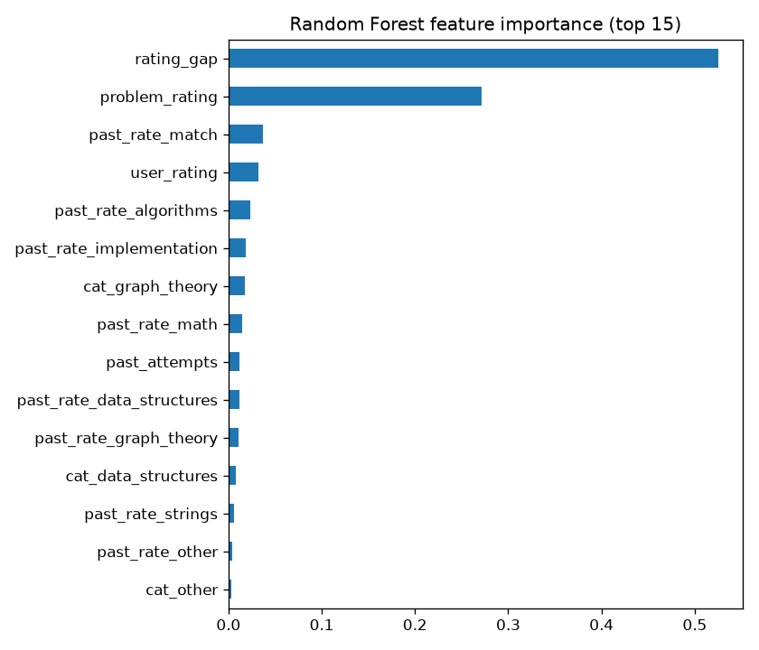

# Classification: solve predictor

- (user, problem) pairs: **140,360**, solved: **49.4%**
- Features (19): user_rating, problem_rating, rating_gap, past_rate_match, past_attempts, past_rate_algorithms, past_rate_data_structures, past_rate_graph_theory, past_rate_implementation, past_rate_math, past_rate_other, past_rate_strings, cat_algorithms, cat_data_structures, cat_graph_theory, cat_implementation, cat_math, cat_other, cat_strings
- Time-based split: train contests 2010-02-25 .. 2026-03-14, test contests 2026-03-16 .. 2026-11-22 (no contest in both)
- SVM trained on a random subsample of at most 8,000 rows (kernel SVM is O(n^2) in memory/time).
- Caveat: Codeforces assigns a problem's rating *after* the contest, from who solved it, so `problem_rating` carries some post-contest information. In a real-time predictor it would have to be replaced by an estimate (e.g. division + index median, the same rule used for imputation). The baseline row shows how much signal that single feature carries.

## Model comparison (impute+zscore)

| model | accuracy | precision | recall | f1 | tn | fp | fn | tp | fit_s |
|---|---|---|---|---|---|---|---|---|---|
| Baseline (gap <= 0) | 0.871 | 0.907 | 0.824 | 0.864 | 13105 | 1184 | 2461 | 11535 | 0.000 |
| DecisionTree (entropy, ~ID3) | 0.884 | 0.902 | 0.860 | 0.881 | 12981 | 1308 | 1959 | 12037 | 1.048 |
| DecisionTree (gini, CART) | 0.886 | 0.893 | 0.875 | 0.884 | 12827 | 1462 | 1756 | 12240 | 0.895 |
| GaussianNB | 0.809 | 0.870 | 0.722 | 0.789 | 12774 | 1515 | 3897 | 10099 | 0.051 |
| BernoulliNB | 0.848 | 0.854 | 0.835 | 0.845 | 12295 | 1994 | 2307 | 11689 | 0.042 |
| SVM (RBF kernel) | 0.890 | 0.883 | 0.895 | 0.889 | 12629 | 1660 | 1463 | 12533 | 0.712 |
| MLP neural network | 0.890 | 0.890 | 0.889 | 0.889 | 12746 | 1543 | 1556 | 12440 | 5.356 |
| RandomForest | 0.891 | 0.892 | 0.887 | 0.889 | 12789 | 1500 | 1586 | 12410 | 5.376 |

Best F1: **RandomForest** (0.889).

## Missing ratings: impute vs drop

8,402 pairs (6.0%) involve a problem with a missing rating.

| model | F1 impute+zscore | F1 drop+zscore | dF1 | acc impute+zscore | acc drop+zscore | F1 impute, rated test rows only |
|---|---|---|---|---|---|---|
| Baseline (gap <= 0) | 0.864 | 0.876 | 0.013 | 0.871 | 0.884 | 0.877 |
| DecisionTree (entropy, ~ID3) | 0.881 | 0.892 | 0.012 | 0.884 | 0.896 | 0.893 |
| DecisionTree (gini, CART) | 0.884 | 0.895 | 0.011 | 0.886 | 0.897 | 0.896 |
| GaussianNB | 0.789 | 0.799 | 0.011 | 0.809 | 0.821 | 0.804 |
| BernoulliNB | 0.845 | 0.858 | 0.013 | 0.848 | 0.862 | 0.856 |
| SVM (RBF kernel) | 0.889 | 0.898 | 0.009 | 0.890 | 0.898 | 0.899 |
| MLP neural network | 0.889 | 0.900 | 0.010 | 0.890 | 0.901 | 0.901 |
| RandomForest | 0.889 | 0.899 | 0.010 | 0.891 | 0.901 | 0.900 |

Read with care: *drop* is scored on a smaller test set without the unrated problems, and those are the hardest rows to predict (their rating is only a median guess). The last column scores the *impute*-trained models on exactly the rows *drop* is scored on; comparing it with the *drop* column isolates the effect of the training data.

**Result:** on identical test rows the mean F1 difference (drop - impute) is -0.0010, so the apparent +0.011 gain of *drop* comes from the easier test set, not from better training. Imputation keeps 6% more data at no cost in accuracy, and lets the warehouse answer difficulty questions about every problem.

## Scaling: zscore vs minmax

| model | F1 impute+zscore | F1 impute+minmax | dF1 | acc impute+zscore | acc impute+minmax |
|---|---|---|---|---|---|
| Baseline (gap <= 0) | 0.864 | 0.864 | 0.000 | 0.871 | 0.871 |
| DecisionTree (entropy, ~ID3) | 0.881 | 0.881 | 0.000 | 0.884 | 0.884 |
| DecisionTree (gini, CART) | 0.884 | 0.884 | 0.000 | 0.886 | 0.886 |
| GaussianNB | 0.789 | 0.789 | 0.000 | 0.809 | 0.809 |
| BernoulliNB | 0.845 | 0.838 | -0.006 | 0.848 | 0.845 |
| SVM (RBF kernel) | 0.889 | 0.884 | -0.005 | 0.890 | 0.884 |
| MLP neural network | 0.889 | 0.890 | 0.001 | 0.890 | 0.890 |
| RandomForest | 0.889 | 0.889 | 0.000 | 0.891 | 0.891 |

Tree-based models are unaffected by monotone rescaling; distance/gradient based models (SVM, MLP) and the Naive Bayes binarization threshold are where scaling matters.

  
