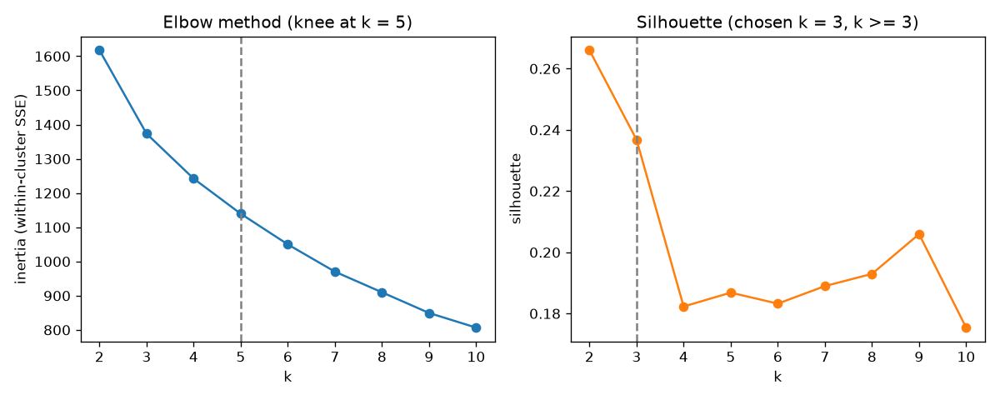
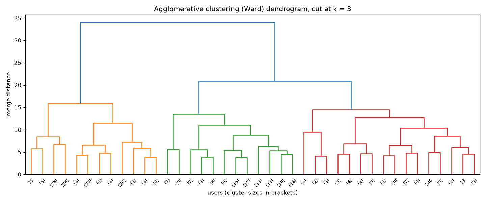
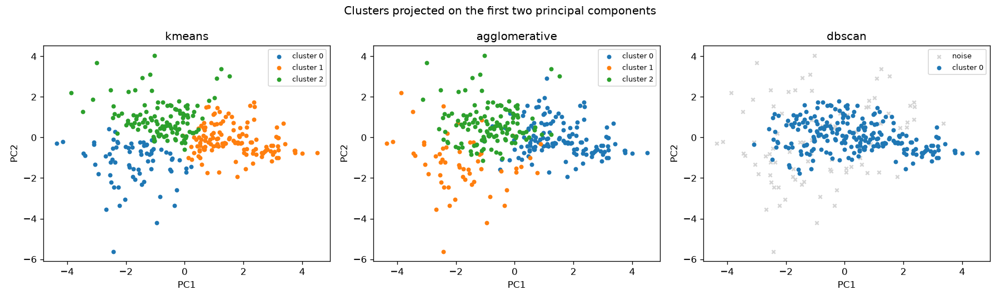

# Clustering: user profiler

- Users: **324** (at least 20 tag-solves), features: share_algorithms, share_data structures, share_graph theory, share_implementation, share_math, share_strings, rating (z-scored)
- K-means, k = 2..10: elbow knee at k = 5; best silhouette overall at k = 2. Chosen: **k = 3**, the best silhouette with k >= 3 (k = 2 only separates strong from weak users, which the rating band already tells us).

| k | inertia | silhouette |
|---|---|---|
| 2 | 1617.509 | 0.266 |
| 3 | 1373.484 | 0.237 |
| 4 | 1242.172 | 0.182 |
| 5 | 1139.570 | 0.187 |
| 6 | 1049.903 | 0.183 |
| 7 | 970.201 | 0.189 |
| 8 | 909.875 | 0.193 |
| 9 | 849.438 | 0.206 |
| 10 | 806.634 | 0.175 |
- DBSCAN: min_samples = 8 (dimensions + 1), eps = 1.28 (55% quantile of the k-distance graph). Rule: best silhouette among settings with >= 2 clusters and <= 30% noise. Outcome: no setting gives 2+ clusters within the noise cap: the users form one dense group (a continuum of profiles), and DBSCAN's noise points are the unusual profiles.

## Silhouette comparison

| algorithm | clusters | noise_points | silhouette |
|---|---|---|---|
| kmeans | 3 | 0 | 0.237 |
| agglomerative | 3 | 0 | 0.214 |
| dbscan | 1 | 90 | n/a (< 2 clusters) |

### DBSCAN eps candidates

| quantile | eps | clusters | noise | silhouette |
|---|---|---|---|---|
| 0.050 | 0.704 | 3 | 271 | 0.430 |
| 0.100 | 0.750 | 2 | 246 | 0.414 |
| 0.150 | 0.815 | 2 | 218 | 0.229 |
| 0.200 | 0.870 | 1 | 199 | nan |
| 0.250 | 0.920 | 1 | 184 | nan |
| 0.300 | 0.959 | 1 | 167 | nan |
| 0.350 | 1.018 | 1 | 146 | nan |
| 0.400 | 1.066 | 1 | 130 | nan |
| 0.450 | 1.126 | 1 | 120 | nan |
| 0.500 | 1.190 | 1 | 101 | nan |
| 0.550 | 1.284 | 1 | 90 | nan |
| 0.600 | 1.342 | 1 | 84 | nan |
| 0.650 | 1.452 | 1 | 70 | nan |
| 0.700 | 1.597 | 1 | 57 | nan |
| 0.750 | 1.760 | 1 | 43 | nan |
| 0.800 | 1.882 | 1 | 33 | nan |
| 0.850 | 2.091 | 1 | 26 | nan |
| 0.900 | 2.423 | 1 | 14 | nan |
| 0.950 | 2.919 | 1 | 5 | nan |

 

## kmeans clusters in plain words

- **Cluster 0** (Pupil / implementation+strings): 74 users averaging 1339 (Pupil); solve relatively more implementation and strings, less graph theory and algorithms.
- **Cluster 1** (Master / graph theory+data structures): 132 users averaging 2278 (Master); solve relatively more graph theory and data structures, less strings and math.
- **Cluster 2** (Specialist / algorithms): 118 users averaging 1578 (Specialist); solve relatively more algorithms, less data structures and graph theory.

## agglomerative clusters in plain words

- **Cluster 0** (Master / data structures+graph theory): 139 users averaging 2238 (Master); solve relatively more data structures and graph theory, less strings and math.
- **Cluster 1** (Pupil / strings+implementation): 57 users averaging 1288 (Pupil); solve relatively more strings and implementation, less algorithms and graph theory.
- **Cluster 2** (Specialist / algorithms): 128 users averaging 1574 (Specialist); solve relatively more algorithms, less data structures and graph theory.

## dbscan clusters in plain words

- **Cluster -1** (noise): 90 users (mean rating 1477) in no dense region: unusual tag mixes.
- **Cluster 0** (Candidate Master / balanced): 234 users averaging 1936 (Candidate Master); tag mix close to the population average.

## K-means centroids (unscaled)

| cluster | share_algorithms | share_data structures | share_graph theory | share_implementation | share_math | share_strings | rating |
|---|---|---|---|---|---|---|---|
| 0 | 0.37 | 0.04 | 0.02 | 0.23 | 0.27 | 0.07 | 1339.01 |
| 1 | 0.38 | 0.08 | 0.07 | 0.19 | 0.24 | 0.04 | 2278.39 |
| 2 | 0.43 | 0.04 | 0.03 | 0.19 | 0.26 | 0.05 | 1578.11 |
