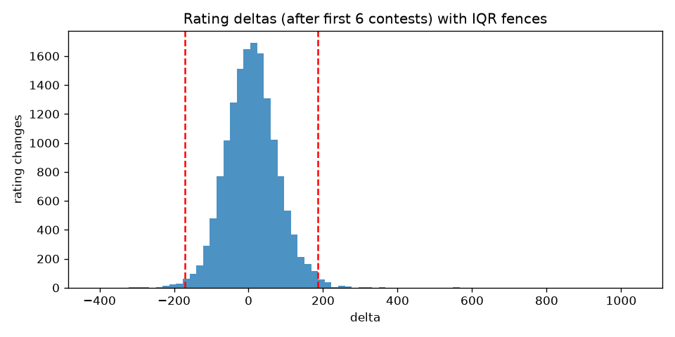
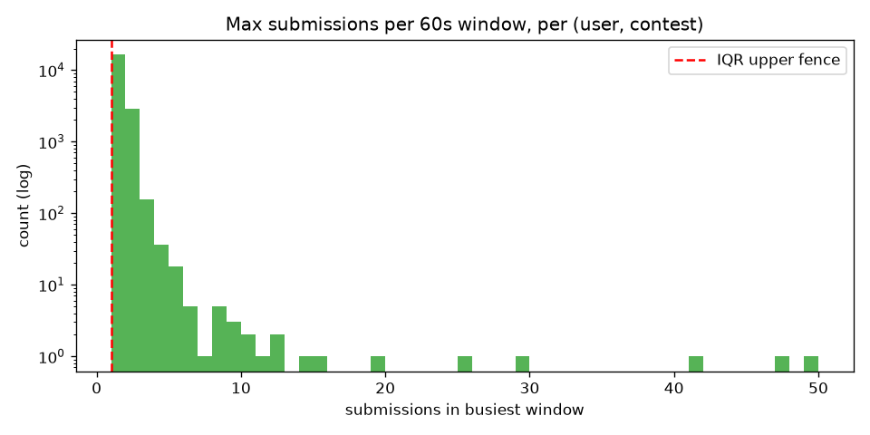

# Outliers: anomaly detector

## Abnormal rating jumps

- Rating changes considered: **15,321** (skipping each user's first 6 contests; users with >= 5 remaining changes)
- Global IQR fences on delta: [-170, 186]; per-user |z| > 3.0
- Flagged: **234** (z-rule: 42, IQR rule: 230)

| handle | contest_name | contest_seq | old_rating | new_rating | delta | z_user |
|---|---|---|---|---|---|---|
| IzhitskiyTimofey | Codeforces Round 1106 (Div. 2) | 107 | 1219 | 1734 | 515 | 4.68 |
| Tlatoani | Polynomial Round 2022 (Div. 1 + Div. 2, Rated, Prizes!) | 78 | 2646 | 2264 | -382 | -4.67 |
| QwertyPi | DeepInfra Round 1 (Codeforces Round 1126, Div. 1 + Div. 2) | 183 | 2503 | 2881 | 378 | 4.41 |
| ksun48 | CodeTON Round 4 (Div. 1 + Div. 2, Rated, Prizes!) | 247 | 3413 | 3001 | -412 | -4.36 |
| AlRntn | Codeforces Round 1052 (Div. 2) | 65 | 2076 | 2351 | 275 | 4.19 |
| Arterm | Mail.Ru Cup 2018 Round 2 | 161 | 2656 | 2337 | -319 | -4.17 |
| Wawi | Spectral::Cup 2026 Round 1 (Codeforces Round 1094, Div. 1 + Div. 2) | 90 | 2189 | 1917 | -272 | -4.15 |
| ApraCadabra | Codeforces Round 862 (Div. 2) | 71 | 2028 | 1792 | -236 | -3.93 |
| tourist | Codeforces Round 470 (rated, Div. 1, based on VK Cup 2018 Round 1) | 135 | 3496 | 3206 | -290 | -3.75 |
| shriganesh83 | Educational Codeforces Round 109 (Rated for Div. 2) | 50 | 925 | 1150 | 225 | 3.66 |
| p0tato | Codeforces Round 666 (Div. 2) | 40 | 1595 | 1842 | 247 | 3.64 |
| amirhoseinfar1385 | Codeforces Round 1079 (Div. 1) | 177 | 2319 | 2570 | 251 | 3.59 |
| Shivam_J_Mishra | Codeforces Round 1121 (Div. 2) | 28 | 746 | 945 | 199 | 3.57 |
| amirhoseinfar1385 | Codeforces Round 800 (Div. 2) | 63 | 1755 | 2003 | 248 | 3.55 |
| seeplusplus | Hello 2024 | 7 | 997 | 1179 | 182 | 3.55 |

## Submission bursts

- (user, contest) pairs: **19,539**; IQR upper fence: 1.0 submissions per 60 s
- Flagged: **81** (z > 3.0 AND above the fence; the IQR fence alone would flag 3,092, because most users never exceed 1 submission per minute, so Q1 = Q3 and IQR = 0)

| handle | contest_name | max_per_window | total | z |
|---|---|---|---|---|
| tourist | Pinely Treasure Hunt Contest | 49 | 520 | 59.63 |
| p0tato | Pinely Treasure Hunt Contest | 47 | 762 | 57.14 |
| KostasKostil | Pinely Treasure Hunt Contest | 41 | 297 | 49.65 |
| baluteshih | Pinely Treasure Hunt Contest | 29 | 404 | 34.69 |
| Golovanov399 | Pinely Treasure Hunt Contest | 25 | 104 | 29.70 |
| Holpens | Pinely Treasure Hunt Contest | 19 | 275 | 22.21 |
| maxplus | VK Cup 2016 - Wild Card Round 2 | 15 | 759 | 17.22 |
| Golovanov399 | AIM Tech Mini Marathon 1 | 14 | 56 | 15.98 |
| maxplus | VK Cup 2015 - Wild Card Round 2 | 12 | 2280 | 13.48 |
| amirhoseinfar1385 | Pinely Treasure Hunt Contest | 12 | 23 | 13.48 |
| maxplus | Pinely Treasure Hunt Contest | 11 | 118 | 12.23 |
| tourist | School Team Contest 3 (Winter Computer School 2010/11) | 10 | 30 | 10.99 |
| Horka | April Fools Day Contest 2026 | 10 | 129 | 10.99 |
| maxplus | Codeforces Marathon Round 1 | 9 | 395 | 9.74 |
| RainRecall | April Fools Day Contest 2026 | 9 | 38 | 9.74 |

A flagged item is a candidate for review, not proof of wrongdoing: a big jump can be a genuinely great contest, and bursts often come from resubmitting after a wrong-answer fix or from interactive / output-only problems.
