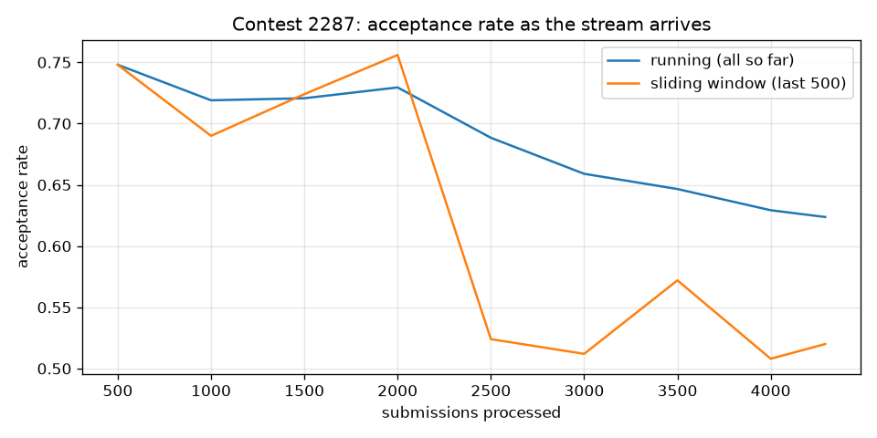

# Stream mining: contest 2287 (replay)

- Submissions processed: **4,292** in 9 batches/polls (each submission seen once; duplicates skipped by id)
- Final acceptance rate: **0.624**

| verdict | count |
|---|---|
| OK | 2677 |
| WRONG_ANSWER | 1136 |
| TIME_LIMIT_EXCEEDED | 213 |
| IDLENESS_LIMIT_EXCEEDED | 82 |
| COMPILATION_ERROR | 72 |
| RUNTIME_ERROR | 40 |
| SKIPPED | 37 |
| MEMORY_LIMIT_EXCEEDED | 30 |
| CHALLENGED | 5 |

| language_family | count |
|---|---|
| C++ | 4090 |
| Python | 113 |
| Java | 35 |
| Rust | 21 |
| C | 16 |
| Other | 7 |
| Kotlin | 5 |
| Go | 4 |
| C# | 1 |

